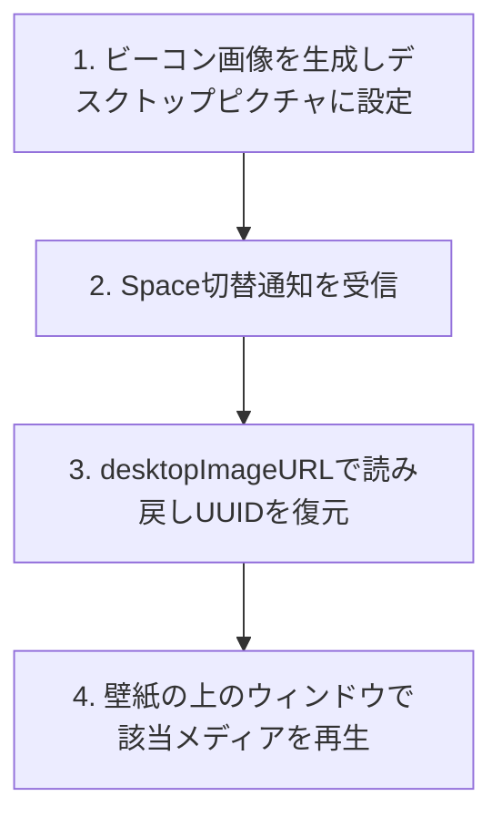

<div align="center">
  <a href="https://github.com/HoshimuraYuto/wall-scene">
    
  </a>
  <h1>Wall Scene</h1>
</div>

<p align="center" style="display: flex; justify-content: center; gap: 20px;">
  <a href="https://ko-fi.com/hoshimurayuto">
    
  </a>
</p>

[English](./README.md) | [日本語](./README.ja.md)

## 🌟 Wall Scene とは？

Wall Scene は、macOS の仮想デスクトップ（Space）ごとに、それぞれ異なる動画・GIF・画像の壁紙を設定できる macOS アプリケーションです。Space を切り替えると、壁紙も自動的に切り替わります。

すべて公開 API のみで実現しており、非公開フレームワークや隠れた entitlement は一切使用していません。技術的な仕組みは後述の「壁紙ビーコンの仕組み」を参照してください。

### 🚀 主な特徴

| モード | できること |
| --- | --- |
| **macOS 標準** | ディスプレイの既存の壁紙設定をそのまま維持 |
| **単一モード** | 1 つの動画・GIF・画像を、そのディスプレイの全 Space でループ再生（または表示） |
| **フォルダモード** | 動画/GIF/画像が入ったフォルダから、各 Space に異なるアイテムをランダムに割り当て、タイマー・ログイン時・スリープ復帰時に再割り当て |

- フォルダモードは壁紙ビーコン技術（後述）で自分がどの Space かを識別
- 単一モードは各 Space のデスクトップピクチャも対応するポスター画像に置き換え、Mission Control に古い壁紙が見えないようにする
- 再接続を跨いでも保持される安定した UUID をキーに、ディスプレイごとに独立設定できるマルチディスプレイ対応
- ディスプレイの接続/切断や解像度変更に自動で追従
- ディスプレイごとに Fill（拡大してクロップ）または Fit（縮小してレターボックス表示）を選択可能
- 動画は `AVQueuePlayer` + `AVPlayerLooper` でループ再生、GIF は `NSImageView` でアニメーション表示、画像は静止表示
- ミュート再生。ディスプレイのスリープを妨げない
- バッテリー駆動時・低電力モード時・サーマルスロットリング時は自動的に静止ポスターフレームへ切り替え、制約が解除されれば自動復帰（ユーザー設定でオン/オフ可能）
- メニューバーアイコンからワンタッチで一時停止/再開・設定へアクセス。すべての壁紙再生を一括停止するグローバルポーズも
- ログイン時の自動起動（`SMAppService` 経由）
- 管理中の Space の壁紙が手動で変更されたことを検知し、既定では管理に戻すか確認ダイアログで尋ねる（設定で挙動を変更可能、ディスプレイごとに「管理に戻す」ボタンで復旧も可能）
- トラブルシューティング用のローカルファイルログ

## 📦 インストール方法

1. [リリースページ](https://github.com/HoshimuraYuto/wall-scene/releases)から最新の `.zip` をダウンロード
2. 解凍し、`wall-scene.app` をアプリケーションフォルダに移動
3. **初回起動時**: このアプリは ad-hoc 署名のみで公証(notarize)されていないため、通常のダブルクリックでは Gatekeeper にブロックされます。これは初回のみ必要な手順です:
   - **macOS 14 (Sonoma)**: アプリを右クリック →「**開く**」→ ダイアログで確認
   - **macOS 15 (Sequoia) 以降**: 一度ダブルクリックする（ブロックされます）→「**システム設定 → プライバシーとセキュリティ**」を開き、下にスクロールして wall-scene の横にある「**このまま開く**」をクリックし、確認する

> ⚠️ 上記と表示が異なる場合、警告ダイアログの正確な文言や流れは macOS のバージョンによって多少異なることがあります。「システム設定 → プライバシーとセキュリティ」内で、このアプリに関する Gatekeeper のプロンプトを探してください。

**必要環境**: macOS 14 (Sonoma) 以降。Universal Binary のため、Apple Silicon と Intel Mac のどちらでもネイティブに動作します。

## 🔧 壁紙ビーコンの仕組み

macOS には Space ごとに異なる*静止画*の壁紙を設定する機能がありますが、AppKit には「現在アクティブな Space がどれか」を確実に知るための公開 API がありません。Space ごとの*動画*壁紙を提供しようとしたアプリはこれまで、非公開 API やウィンドウ ID を使ったヒューリスティックで対処するか、機能をうたいながら実際には実装されていない、というケースがほとんどでした。

「現在どの Space がアクティブか」を尋ねる公開 API は存在しませんが、現在のデスクトップピクチャを読み戻す公開 API は存在します。Wall Scene は壁紙そのものを識別子として利用します。

1. **ビーコンを生成**: フォルダモードが Space にメディアを割り当てる際、一意な静止画（選択した動画/GIF の先頭フレームから抽出、または画像そのものを使った `beacon-<UUID>.heic`）を生成し、`setDesktopImageURL(_:for:)` でその Space のデスクトップピクチャとして設定します。
2. **通知を受け取る**: Space が切り替わる通知が来るたびに、Wall Scene は新しくアクティブになった Space を識別する処理を開始します。
3. **読み戻して UUID を復元**: `desktopImageURL(for:)` でデスクトップピクチャの URL を読み戻し、ファイル名から UUID を復元します。
4. **該当メディアを再生**: その Space がループ再生すべきメディアを特定し、壁紙のすぐ上に重ねたボーダーレスウィンドウで再生します。



関係する 2 つの API（`setDesktopImageURL` / `desktopImageURL(for:)`）はいずれも公開・ドキュメント化されたもので、非公開フレームワークや entitlement の回避、SIP の変更は一切利用していません。

## ❓ よくある質問

### Mission Control や Spaces バーで、再生中の動画ではなく静止画が表示されるのはなぜですか？

Wall Scene は OS の非公開な壁紙描画パスではなく、デスクトップの上に重ねた通常のウィンドウとして壁紙を描画しています。Mission Control のサムネイルは（そのウィンドウの内容ではなく）実際のデスクトップピクチャ（ビーコン/ポスター画像）を反映するため、Mission Control 中は動画がポスターフレームで一時停止しているように見えます。

これは公開 API のみに留めるための意図的なトレードオフです。非公開 API に依存して Apple の変更に怯えるのではなく、OS アップデートで壊れにくく、macOS 14 以降のどの Mac でも動作するようにするための代償です。

### システム設定から手動でデスクトップピクチャを変更するとどうなりますか？

ビーコン/ポスター方式は、Wall Scene が設定したデスクトップピクチャがそのまま維持されていることに依存しています（それを読み戻すことで、どの Space にいるかを判断しているため）。Wall Scene が管理している Space に対して手動で新しい壁紙を選んだり（あるいはダイナミック/シャッフル壁紙を有効にしたり）すると、その Space の識別が壊れます。ただし、その Space に戻った時点（フォルダモードでは定期チェック時）で Wall Scene がこれを検知します。

既定の設定（「確認する」）では、「壁紙が手動で変更されました」というダイアログが表示されます。「**管理に戻す**」を選ぶとビーコン/ポスターを再適用してその Space の管理を再開し、「**このスペースを管理しない**」を選ぶと現在の壁紙をそのまま維持し、以後 Wall Scene はそのスペースに関与しなくなります。

この挙動は設定画面の「壁紙が手動で変更されたら」から変更できます。「**常に元に戻す**」を選ぶと確認なしで自動的にビーコンを再適用し、「**そのスペースを管理しない**」を選ぶと確認なしで自動的に管理対象から外します。いずれかのポリシーで管理対象外になった Space は、設定画面に「（ディスプレイ名）: 管理外のスペースが N 件」として一覧表示され、「**管理に戻す**」ボタンから次に訪れたときに管理を再開できます。

また、ディスプレイを単一モードやフォルダモードに切り替えると、そのディスプレイが触れるすべての Space の壁紙が置き換わります。「macOS 標準」に戻しても元の壁紙は保存・復元されないため、システム設定から手動で選び直す必要があります。

### 対応しているファイル形式は？

Wall Scene はファイル拡張子をハードコードされたリストと照合するのではなく、macOS の型システム（UTType）に対して、そのファイルが GIF か、動画か、画像かを（この順序で）問い合わせ、それ以外は非対応として扱います。実際の再生可否は、その後段のフレームワーク次第です。動画は AVFoundation（`AVQueuePlayer`）でデコードされ、GIF は `NSImageView` でアニメーション表示され、画像は `NSImage` で読み込まれます。

実際には以下のようになります。動画 — `.mov` / `.mp4` / `.m4v`（H.264、HEVC など）、GIF — `.gif`、画像 — `.png` / `.jpeg` / `.heic` / `.tiff` / `.webp` など `NSImage` がデコードできる形式。

**WebM と MKV は非対応です**: macOS の型システムはこれらを「動画」として分類し、ファイル選択画面で選べてしまうことがありますが、AVFoundation がデコードできないため実際には再生されません。事前に ffmpeg で変換してください。

```sh
ffmpeg -i input.webm -c:v libx264 -pix_fmt yuv420p output.mp4
```

または HEVC を使う場合:

```sh
ffmpeg -i input.webm -c:v libx265 -tag:v hvc1 -pix_fmt yuv420p output.mp4
```

### アプリの言語を変更するには？

Wall Scene は macOS の言語設定に従い、English と日本語に対応しています。Wall Scene だけ言語を変えたい場合は、システム設定 → 一般 → 言語と地域 を開き、「アプリケーション」に Wall Scene を追加して使いたい言語を選んでください。変更を反映するにはアプリを再起動してください。

### ログファイルはどこに保存されますか？削除しても大丈夫ですか？

Wall Scene はトラブルシューティング用のログを `~/Library/Application Support/WallScene/Logs/wallscene.log` に書き込みます。ファイルサイズは約 2MB を上限としており、超過すると `wallscene.log.old` に退避（直近1世代のみ保持）した上で新しいログファイルが作成されます。これらのファイルは問題調査のためだけに存在するので、いつでも削除して構いません。削除しても Wall Scene が自動的に再作成します。

## 💻 開発者向け情報

### 必要環境

- macOS 14 (Sonoma) 以降
- Xcode（最新の安定版を推奨）

### ビルド方法

```bash
git clone https://github.com/HoshimuraYuto/wall-scene.git
cd wall-scene
open wall-scene.xcodeproj
```

Xcode 上でビルド・実行してください（**Product → Run**、または `⌘R`）。

コマンドラインからビルドする場合は次のようにします。

```bash
xcodebuild -project wall-scene.xcodeproj -scheme wall-scene -configuration Release build
```

### 開発環境のセットアップ

1. git hooks を設定

```bash
sh ./setup-hooks.sh
```

このセットアップには以下が含まれます:

- コミット前の自動コードフォーマット
- コミットメッセージが [Angular Commit Message Conventions](https://github.com/angular/angular/blob/master/CONTRIBUTING.md#-commit-message-format) の形式になっているかチェック

## 🤝 コントリビュート

### 💝 プロジェクトを支援

- [Ko-fi](https://ko-fi.com/hoshimurayuto) で開発者を応援

<a href="https://ko-fi.com/hoshimurayuto">
  
</a>

### 📢 プロジェクトを広める

- プロジェクトに ⭐️ をつける
- Twitter や SNS でプロジェクトをシェア
- ブログや技術記事で紹介

### 🛠️ プロジェクトに貢献

1. リポジトリをフォーク
2. フィーチャーブランチを作成
3. 変更をコミット
4. ブランチにプッシュ
5. プルリクエストを作成

## 📜 ライセンス

このプロジェクトは GNU General Public License v3.0 の下でライセンスされています。詳細は [LICENSE](https://github.com/HoshimuraYuto/wall-scene/blob/main/LICENSE) ファイルを参照してください。
