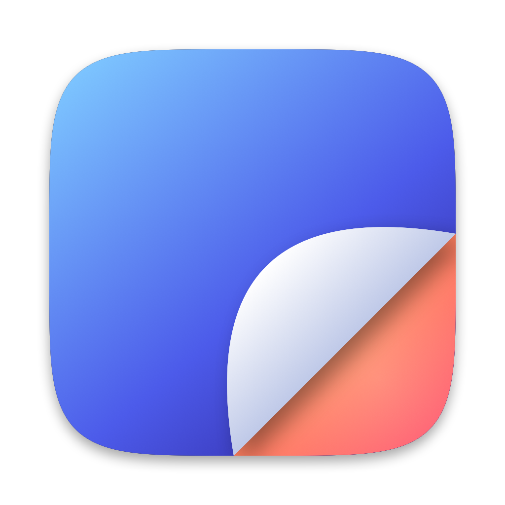
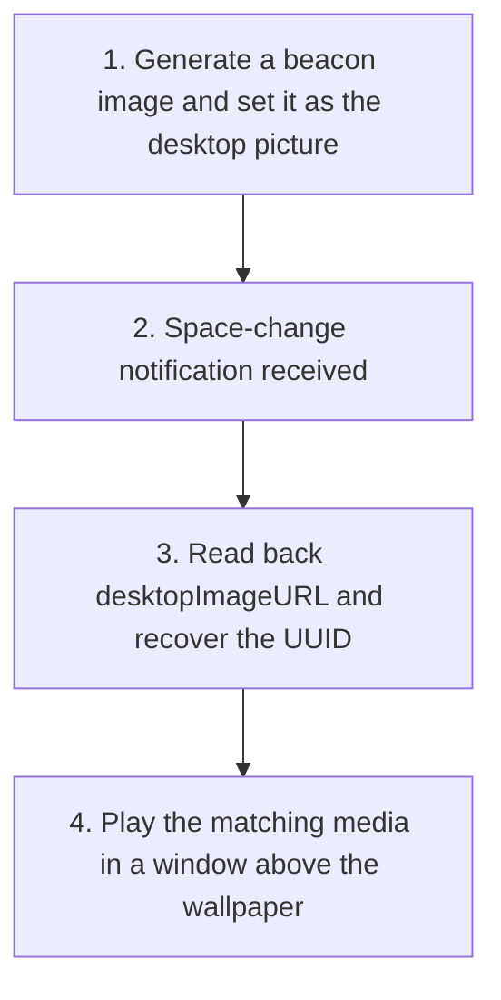

<div align="center">
  <a href="https://github.com/HoshimuraYuto/wall-scene">
    
  </a>
  <h1>Wall Scene</h1>
</div>

<p align="center" style="display: flex; justify-content: center; gap: 20px;">
  <a href="https://ko-fi.com/hoshimurayuto">
    
  </a>
</p>

[English](./README.md) | [日本語](./README.ja.md)

## 🌟 What is Wall Scene?

Wall Scene is a macOS application that gives every virtual desktop (Space) its own video, GIF, or image wallpaper — a different wallpaper for every Space. Switch to a different Space, and the wallpaper switches with it, automatically.

It does this entirely through public macOS APIs, with no private frameworks or hidden entitlements involved. See "How It Works" below for the technical details.

### 🚀 Key Features

| Mode | What it does |
| --- | --- |
| **macOS standard** | Leaves the display's existing wallpaper settings untouched |
| **Single** | One video, GIF, or image loops (or displays) across every Space on that display |
| **Folder** | A folder of videos/GIFs/images, with a different item randomly assigned to each Space, re-rotated on a timer, on login, or on wake |

- Folder mode identifies its own Space using the wallpaper-beacon technique (see "How It Works")
- Single mode also sets a matching poster image per Space, so Mission Control never shows a stale wallpaper underneath
- Multi-display support, with each display configured independently via a stable UUID that survives reconnects
- Reacts automatically to display connect/disconnect and resolution changes
- Fill (cropped) or Fit (letterboxed) scaling, chosen per display
- Videos loop via `AVQueuePlayer` + `AVPlayerLooper`; GIFs animate via `NSImageView`; images are shown statically
- Muted playback that never prevents display sleep
- Drops to a static poster frame on battery power, in Low Power Mode, or under thermal throttling — and recovers automatically once the constraint clears (toggleable per user)
- Menu bar icon for quick pause/resume and settings, plus a global pause for all wallpaper playback
- Launch at login via `SMAppService`
- Detects when a managed Space's wallpaper is changed manually and, by default, asks whether to resume managing it — configurable in Settings, with a per-display "Resume Managing" recovery option
- Local file logging for troubleshooting

## 📦 Installation

1. Download the latest `.zip` from the [releases page](https://github.com/HoshimuraYuto/wall-scene/releases)
2. Unzip the file and move `wall-scene.app` to your Applications folder
3. **First launch**: the app is ad-hoc signed (not notarized), so Gatekeeper will block a plain double-click. This is only needed once:
   - **macOS 14 (Sonoma)**: right-click the app → **Open** → confirm in the dialog.
   - **macOS 15 (Sequoia) and later**: double-click once (it will be blocked), then open **System Settings → Privacy & Security**, scroll down, click **Open Anyway** next to wall-scene, and confirm.

> ⚠️ If you don't see the warning dialog described above, the exact wording/flow can vary slightly by macOS version — look for a Gatekeeper prompt referencing the app under System Settings → Privacy & Security.

**Requirements**: macOS 14 (Sonoma) or later. Universal binary — runs natively on both Apple Silicon and Intel Macs.

## 🔧 How It Works: The Wallpaper Beacon

macOS lets you set a different *static* wallpaper per Space, but nothing in AppKit lets an app reliably know which Space is currently active — there is no public API for that. Every app that has tried to offer per-Space *video* wallpapers has worked around this with private APIs, window-ID heuristics, or simply hasn't shipped the feature despite advertising it.

There is no public API to ask "which Space is active right now" — but there *is* a public API to read back the current desktop picture. Wall Scene turns the wallpaper itself into the identifier.

1. **Generate a beacon**: when folder mode assigns a Space, Wall Scene generates a unique static image (a `beacon-<UUID>.heic`, extracted from the chosen video/GIF's first frame, or the image itself) and sets it as that Space's desktop picture via `setDesktopImageURL(_:for:)`.
2. **Receive the notification**: on every Space-change notification, Wall Scene wakes up to identify the newly active Space.
3. **Read back and recover the UUID**: it reads the desktop image URL via `desktopImageURL(for:)` and recovers the UUID from the filename.
4. **Play the right media**: it looks up which media that Space should be looping, then plays it in a borderless window layered just above the wallpaper.



Both APIs involved (`setDesktopImageURL` / `desktopImageURL(for:)`) are public and documented — no private frameworks, entitlement workarounds, or SIP changes are involved.

## ❓ FAQ

### Why does Mission Control / the Spaces bar show a static frame instead of the playing video?

Wall Scene renders wallpapers in a regular window layered above the desktop, not through the OS's private wallpaper-rendering path. Mission Control's thumbnails reflect the actual desktop picture (the beacon/poster image), not that window's contents — so during Mission Control the video appears paused on its poster frame.

That's the deliberate cost of staying entirely on public APIs. It's the tradeoff that makes Wall Scene unlikely to break on an OS update and able to run on any Mac running macOS 14+, rather than depending on private APIs an author has to hope Apple doesn't change.

### What happens if I change the desktop picture manually from System Settings?

The beacon/poster method depends on the desktop picture staying exactly what Wall Scene set it to — that's what it reads back to know which Space it's in. Manually picking a new wallpaper (or turning on a dynamic/shuffling wallpaper) for a Space that Wall Scene is managing breaks that Space's identification — but Wall Scene detects this, either as soon as you return to that Space or, in Folder mode, on its periodic re-check.

By default ("Ask"), a dialog appears: "The wallpaper was changed manually." Choosing **Resume Managing** re-applies the beacon/poster and puts the Space back under management; choosing **Don't Manage This Space** keeps your current wallpaper as-is and stops Wall Scene from touching that Space.

You can change this behavior in Settings → *When wallpaper is changed manually*: **Always restore** re-applies the beacon automatically without asking, and **Stop managing that space** automatically leaves it alone without asking. Whichever policy leaves a Space unmanaged, Settings lists it under "Unmanaged spaces on \<display\>" with a **Resume Managing** button to bring it back under management the next time you visit it.

Also note: switching a display *into* single or folder mode replaces the wallpaper on every Space it touches, and the original wallpaper is not saved or restored if you switch back to "macOS standard" — you'll need to reselect it yourself in System Settings.

### Which file formats are supported?

Wall Scene doesn't match file extensions against a hardcoded list — it asks macOS's type system (UTType) whether a file is a GIF, a movie/video, or an image, checked in that order, and treats anything else as unsupported. What actually plays back is then up to the underlying framework: videos are decoded by AVFoundation (`AVQueuePlayer`), GIFs are animated by `NSImageView`, and images are loaded by `NSImage`.

In practice that means: video — `.mov` / `.mp4` / `.m4v` (H.264, HEVC, etc.); GIF — `.gif`; images — `.png` / `.jpeg` / `.heic` / `.tiff` / `.webp` and other formats `NSImage` can decode.

**WebM and MKV are not supported**: macOS's type system may still classify them as a "movie" and let you pick them in the file browser, but AVFoundation cannot decode them, so they will not actually play. Convert them first with ffmpeg:

```sh
ffmpeg -i input.webm -c:v libx264 -pix_fmt yuv420p output.mp4
```

or, for HEVC instead of H.264:

```sh
ffmpeg -i input.webm -c:v libx265 -tag:v hvc1 -pix_fmt yuv420p output.mp4
```

### How do I change the app's language?

Wall Scene follows the language settings of macOS and is available in English and 日本語 (Japanese). To change the language for Wall Scene only, open System Settings → General → Language & Region, add Wall Scene under Applications, and pick the language you want. Relaunch the app for the change to take effect.

### Where are the log files stored, and can I delete them?

Wall Scene writes troubleshooting logs to `~/Library/Application Support/WallScene/Logs/wallscene.log`. The file is capped at ~2 MB: once it reaches that size, it's rotated to `wallscene.log.old` (only the most recent generation is kept) and a fresh log starts. These files exist only to help diagnose problems — it's safe to delete them at any time, and Wall Scene recreates them automatically.

## 💻 Developer Information

### Requirements

- macOS 14 (Sonoma) or later
- Xcode (latest stable recommended)

### Build Instructions

```bash
git clone https://github.com/HoshimuraYuto/wall-scene.git
cd wall-scene
open wall-scene.xcodeproj
```

Then build and run from Xcode (**Product → Run**, or `⌘R`).

Alternatively, build from the command line:

```bash
xcodebuild -project wall-scene.xcodeproj -scheme wall-scene -configuration Release build
```

### Development Environment Setup

1. Set up git hooks

```bash
sh ./setup-hooks.sh
```

This setup includes:

- Automatic code formatting before commits
- Checking if commit messages follow [Angular Commit Message Conventions](https://github.com/angular/angular/blob/master/CONTRIBUTING.md#-commit-message-format)

## 🤝 Contributing

### 💝 Support the Project

- Support the developer on [Ko-fi](https://ko-fi.com/hoshimurayuto)

<a href="https://ko-fi.com/hoshimurayuto">
  
</a>

### 📢 Spread the Project

- Give the project a ⭐️
- Share the project on Twitter and social media
- Write about it in blogs and technical articles

### 🛠️ Project Contributions

1. Fork the repository
2. Create a feature branch
3. Commit your changes
4. Push to the branch
5. Create a Pull Request

## 📜 License

This project is licensed under the GNU General Public License v3.0. See the [LICENSE](https://github.com/HoshimuraYuto/wall-scene/blob/main/LICENSE) file for details.
